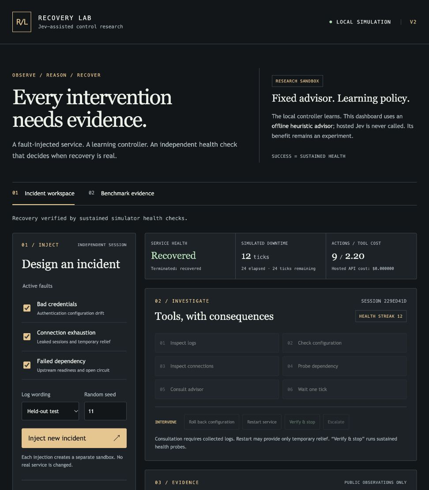
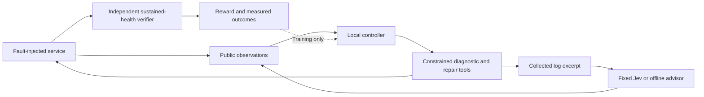

# Recovery Lab

**Train incident-recovery agents. Inspect every decision. Verify recovery independently.**

[](https://github.com/Vajraaaang/jev-rl/actions/workflows/ci.yml)
[](pyproject.toml)
[](LICENSE)

[Quickstart](#quickstart) · [Use Jev](#use-hosted-jev) · [Results](#measured-results) · [Documentation](#documentation) · [Contributing](CONTRIBUTING.md)

Recovery Lab is a local research platform for training a reinforcement-learning controller to investigate and repair a fault-injected service. Jev can rank possible causes from collected logs; the controller chooses diagnostics and interventions; independent health probes determine whether recovery lasts.

> **Research status:** the included results and checkpoints use an offline heuristic advisor. Hosted Jev integration is available, but these results do not establish Jev effectiveness or production readiness.



*Local incident console from a recorded simulator run. The dashboard exposes service health, action costs and a decision/consequence timeline.*

## Quickstart

Requires **Python 3.10+**. The runtime has no external Python dependencies, database requirement or frontend build step.

```sh
git clone https://github.com/Vajraaaang/jev-rl.git "$HOME/jev-rl"
cd "$HOME/jev-rl"
python3 -m jev_recovery serve --port 8080
```

Open **http://127.0.0.1:8080**. Inject an incident, inspect logs and configuration, then run the checklist or a saved learned controller. The default advisor is offline, so no API key or hosted request is needed.

To run an incident programmatically:

```python
from jev_recovery.agent import ChecklistPolicy, RecoveryAgent
from jev_recovery.sandbox import IncidentEnv
from jev_recovery.scenarios import Incident

env = IncidentEnv(Incident(
    id="quickstart",
    faults=("credentials", "connections", "dependency"),
))
result = RecoveryAgent(ChecklistPolicy()).run(env)
print({"recovered": result["recovered"], "actions": result["actions"]})
```

## Use hosted Jev

Run this from the checkout in an interactive terminal:

```sh
python3 -m jev_recovery serve --advisor live --prompt-key
```

Enter your TypeSafe API key at the hidden prompt. It stays in the server process for that run; it is not saved to a file or sent to the browser. If `TYPESAFE_API_KEY` is already exported, omit `--prompt-key`.

In the dashboard, select **Inspect logs**, then **Consult advisor**. The result identifies a fresh hosted response, cache hit or unavailable diagnosis. Requests use the existing pinned `jev-1.13.0` model and three independent text questions; only the local controller learns. See TypeSafe's [API reference](https://docs.typesafe.ai/api) and [model documentation](https://docs.typesafe.ai/models).

| Advisor mode | Command | Behavior |
|---|---|---|
| Offline | `python3 -m jev_recovery serve` | Local heuristic; no hosted requests |
| Live | `python3 -m jev_recovery serve --advisor live --prompt-key` | Hosted Jev on cache misses |
| Cached | `python3 -m jev_recovery serve --advisor cached` | Saved Jev responses only; no network acquisition |

One provider is shared across dashboard sessions so call/cost guards and the cache apply across them. Missing credentials fail startup in live mode. Displaying a hosted report does not change the dashboard mode, and enabling Jev does not retrain the included offline checkpoints. Authentication errors, network failures and cache misses never become successful recovery.

## Core capabilities

- **Causal incidents:** concurrent faults, seeded recovery timing, restart downtime, recurrent pool exhaustion and archived-log distractors.
- **Observable agents:** defensive public observations, evidence ledger, cause hypotheses, decision summaries and tool consequences.
- **Local learning:** feature-based Q-learning with equal training budgets, validation-only checkpoint selection and frozen evaluation.
- **Bounded execution:** predefined tools, inspection preconditions, intervention limits and explicit escalation.
- **Independent outcomes:** sustained end-to-end health checks, separate diagnostic-quality metrics and decomposed rewards/costs.
- **Reproducible experiments:** paired scenarios, recorded sensor responses, checksummed artifacts, semantic audits and deterministic replay.

## How it works



| Fault | Durable recovery | Why a restart can mislead |
|---|---|---|
| Incorrect database credentials | Restore known-good configuration | Authentication remains broken |
| Exhausted connections | Roll back the leak configuration, then flush exhausted sessions | Temporary relief ends when the leak saturates the pool again |
| Failed dependency | Wait for reachability, then reset the circuit | Restart cannot repair an external dependency |

Every action consumes simulated time. Restart and rollback cause downtime. Recovery requires **12 consecutive independent healthy probes within the deadline**, longer than every generated recurrence window. Permanent failures and tight deadlines can make an incident unrecoverable; escalation is recorded separately.

Policies receive public evidence, not the simulator or hidden fault labels. Jev receives only explicitly collected logs and cannot grade recovery. The system exposes no production shell or arbitrary remediation tool. Read the [architecture](docs/architecture.md) and [security boundaries](docs/security.md) before adapting it to real infrastructure.

## Measured results

The recorded v2 study contains **4,320 paired evaluation trajectories**, six comparison arms, four suites and three controller seeds. Each trained arm consumed 4,000 episodes per seed; fixed intermediate candidates were selected on separate validation incidents. Test outcomes did not select checkpoints.

| Policy | Overall recovery | Mean actions | Downtime ticks | Tool cost units |
|---|---:|---:|---:|---:|
| Troubleshooting checklist | 77.5% | 13.71 | 12.37 | 4.16 |
| Random actions | 13.9% | 6.09 | 7.11 | 1.28 |
| Repair-first baseline | 45.0% | 14.98 | 19.32 | 0.12 |
| RL without advisor | 22.2% | 2.25 | 2.15 | 0.42 |
| RL with offline advisor | 62.1% | 8.33 | 9.99 | 2.21 |
| Same advisor-enabled RL with corrupted scores | 63.2% | 8.33 | 10.02 | 2.19 |

Overall rates include structurally impossible incidents. The checklist recovered every feasible incident in this recorded study. Low action counts can reflect early escalation rather than effective recovery; read cost and downtime alongside recovery.

**Corrupted scores preserved performance.** The difference between trained arms therefore does not establish useful diagnostic advice as the cause of improvement. No hosted Jev call produced this benchmark. This is exploratory synthetic research with finite wording templates and limited seed variability, not an untouched external lockbox or evidence of production transfer.

The [full report](artifacts/research/report.md) and [machine-readable metrics](artifacts/research/report.json) include paired uncertainty, cause-quality scores and breakdowns by recoverability, seed, noise and fault combination. See [evaluation methodology](docs/evaluation.md) and the [model card](docs/model-card.md).

## Run a reproducible experiment

Use a **new, empty output directory** for every run. Existing experiment evidence is never overwritten.

```sh
python3 -m jev_recovery benchmark --config "$PWD/configs/smoke.json" --output "$PWD/artifacts/my-smoke-run" --cache "$PWD/artifacts/my-smoke-diagnostics.json"
python3 -m jev_recovery audit --output "$PWD/artifacts/my-smoke-run"
python3 -m jev_recovery replay --output "$PWD/artifacts/my-smoke-run"
```

Use `configs/research.json` for the full protocol. JSON configs accept `episodes`, `count`, `seeds` and `advisor_mode`; file values override CLI settings. The CLI resolves paths internally; Python APIs require absolute artifact paths.

For a new hosted comparison, export `TYPESAFE_API_KEY` in your shell and explicitly select live mode:

```sh
python3 -m jev_recovery benchmark --advisor live --cache "$PWD/artifacts/hosted-cache.json" --output "$PWD/artifacts/my-hosted-run"
```

Use `--advisor cached` with the same cache for a network-free acquisition replay. Recorded-run `replay` reproduces fixed policies and stored sensor responses without calling Jev. Audit verifies manifests, split boundaries, pairing, budgets, checkpoint selection, metrics and hashes. Unsigned checksums establish consistency, not authenticity against an actor who can replace every artifact.

| Artifact | Purpose |
|---|---|
| `manifest.json` / `training.json` | Fixed incidents, configuration, training budgets and checkpoint selection |
| `checkpoints/` | Frozen learned weights with feature/action schemas |
| `episodes.jsonl` | Full decision, evidence, consequence and sensor-response traces |
| `diagnostics.json` | Independent cause-classification study |
| `report.md` / `report.json` | Results, uncertainty, costs and limitations |
| `integrity.json` | SHA256 inventory for audit and replay |

The original tabular prototype remains in [baseline artifacts](artifacts/baseline) with [separate instructions](docs/baseline.md). Its dataset and verification window differ from v2; its rates are not a controlled before/after comparison.

## Development

```sh
python3 -m unittest discover -s "$PWD/tests" -v
python3 -m compileall -q "$PWD/jev_recovery"
```

The CI workflow runs installation, tests, a smoke benchmark, audit and replay on Python 3.10–3.13. The workflow badge reports hosted status; local test results are separate. An installable wheel includes the console assets, and the Dockerfile packages the offline research runtime. The package is not advertised as a published PyPI release.

The adapter redacts common text/JSON/URI secrets, refuses redirects, bounds requests/retries/timeouts, records acquisition costs and uses checked atomic caches. Redaction and conservative dollar admission are best effort, not guarantees about every log format or provider invoice. See [security boundaries](docs/security.md).

## Documentation

| Guide | What it covers |
|---|---|
| [Architecture](docs/architecture.md) | Agent, simulator, controller and sensor boundaries |
| [Evaluation](docs/evaluation.md) | Splits, outcome measures, paired uncertainty and interpretation |
| [Model card](docs/model-card.md) | Intended use, training data, selection and failure modes |
| [HTTP API](docs/api.md) | Local sessions, tools, errors and advisor modes |
| [Security](docs/security.md) | Keys, logs, execution scope and artifact trust |
| [Validation record](docs/validation.md) | Historical observed checks and their limits |
| [Baseline](docs/baseline.md) | Original tabular experiment |

## Contributing and license

Read [CONTRIBUTING.md](CONTRIBUTING.md) for validation and evidence requirements, and [SECURITY.md](SECURITY.md) for responsible vulnerability reporting. Recovery Lab is available under the [MIT license](LICENSE).
