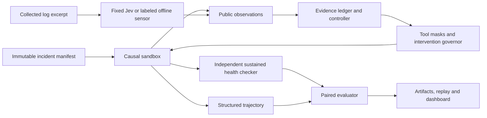

# Architecture

| Module | Responsibility | Boundary |
|---|---|---|
| scenarios.py | Frozen manifests and seeded dynamics | Labels belong to simulator/evaluator |
| sandbox.py | Action consequences, diagnostics, reward and probes | Advice cannot decide health |
| agent.py | Defensive observations, ledger, tools and budgets | Policies never receive the world object |
| learning.py | Local Q-learning and validation selection | Frozen evaluation cannot update weights |
| jev.py | Fixed-model transport, redaction, cache, provenance | Hosted/offline evidence stays distinct |
| benchmark.py | Paired comparisons, classification study, audits/replay | Ground truth is applied after prediction |
| service.py and web/ | Independent sessions and recovery console | Local predefined tools, no arbitrary execution |
| cli.py | Validated configuration and lifecycle | Live acquisition must be explicit |

Observations contain health, time, remaining budget, verification window, collected evidence, last action/outcome and counts. Unknown evidence is null. Fault tuples, scenario IDs, split labels, seeds and structural feasibility never enter policy inputs. Copies prevent a policy mutating the simulator.

Repairs invalidate affected live diagnostics; captured logs and diagnosis remain historical evidence. Consultation requires collected logs. Provider exceptions are redacted failures, not recovery. Tool masks prevent repetitive inspection without a state change. Invalid selections escalate with a recorded block.

Linear Q-learning uses bounded public features and action-specific weights. Actual rewards drive updates, without expert repair labels. Both arms share an action-independent incident schedule. Intermediate candidates are evaluated greedily on validation and the best reward checkpoint is frozen after the full training budget finishes.

Every run records configuration, manifests, runtime/Git/source identity, feature versions, checkpoint hashes, selection scores, exact sensor records and trajectories. Source identity is captured before training and checked afterward. Replay reconstructs scenarios and compares every selected action, observation, consequence, reward, metric and trace using recorded diagnostics, without acquisition. Hashes are unsigned consistency evidence rather than authorship attestations.

V1 environment.py/policy.py preserve the original prototype independently.
